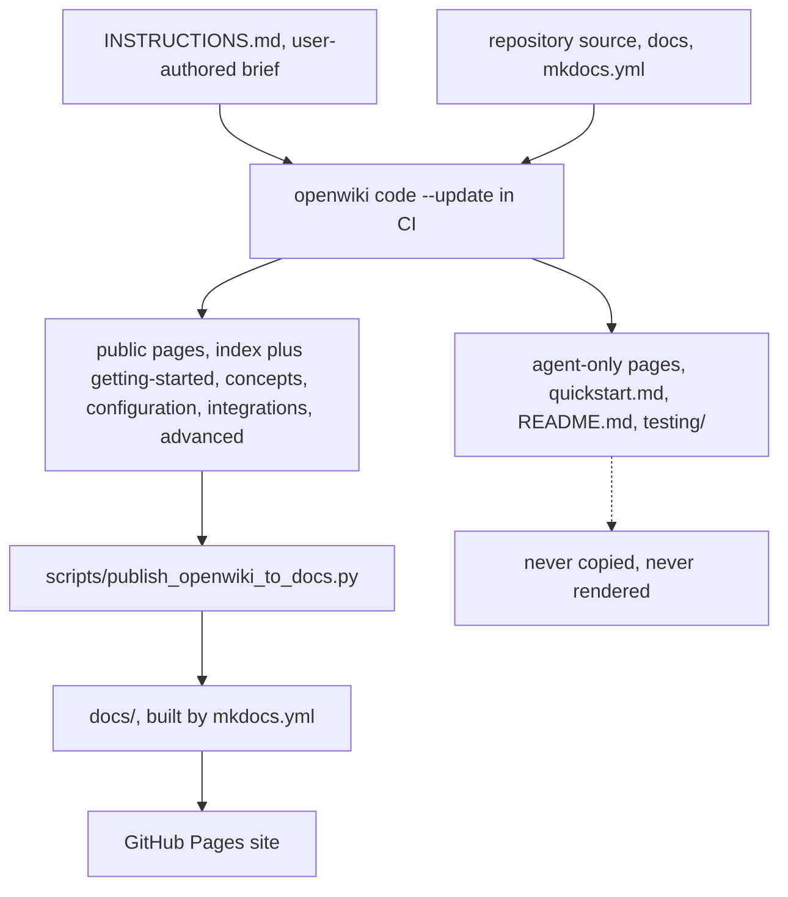

# openwiki/ Orientation

`openwiki/` is this repository's generated documentation tree for coding
agents. It is the same content GitHub Pages serves, plus a small set of
agent-only pages that never reach the site. This page orients an agent that
already has the tree in front of it: which pages exist, which files are
inputs rather than output, and what happens between a merge to `main` and a
published docs page.

For task routing, [Cite-Right Wiki Quickstart](quickstart.md) is the entry
point. It maps each kind of question to the page that answers it.

## The Two Readerships In This Tree

Every file under `openwiki/` falls into one of three buckets, and knowing the
bucket decides how you may treat the file: the brief you author, the pages
OpenWiki generates for readers, and the pages it generates for agents only.



The generated content is the pages, not the brief. `openwiki/INSTRUCTIONS.md`
is the only hand-authored file here; it is the brief OpenWiki reads on every
run and never overwrites. Everything else in the tree is regenerated, so
hand-editing a generated page is lost on the next run.

**Public pages** mirror the navigation in `mkdocs.yml`: `index.md` plus
16 content pages across `getting-started/`, `concepts/`, `configuration/`,
`integrations/`, and `advanced/`. The API Reference section of the site is not
generated here; it stays in `docs/api/` via mkdocstrings.

**Agent-only pages** are [Cite-Right Wiki Quickstart](quickstart.md), this
orientation page, and the two references under
[testing](testing/index.md) ---
[Contract Tests](testing/contract-tests.md) and
[Pytest Markers](testing/pytest-markers.md). They may name `openwiki/`
paths and source files, which public pages must not do. The brief forbids a
second public tree such as `architecture/` or `operations/`; agent depth
belongs in `testing/` or nowhere.

One correction worth carrying if you remember an older shape of this tree: the
configuration reference is now a single page,
`configuration/citation-config.md`, that covers every `CitationConfig` and
`CitationWeights` field. There is no separate reference page per field group.

## What Steers A Run

| File | Authored by | Role |
| --- | --- | --- |
| `openwiki/INSTRUCTIONS.md` | you | the brief: public path list, voice rules, invariants, agent-only rules. Read on every run, never rewritten |
| `AGENTS.md` | generated OpenWiki block | the agent contract: when to retrieve, that source and tests win, that generated pages are not hand-edited |
| `CLAUDE.md` | generated OpenWiki block | pulls in `AGENTS.md` with `@AGENTS.md`, so both files stay in step |
| `mkdocs.yml` | you | the public navigation the generated public paths must match |
| `docs/` | you | the published tree, including the voice anchors named in the brief |
| `src/`, `tests/`, `rust_core/` | you | the system the pages describe, and the tie-breaker when prose and code disagree |

The OpenWiki blocks in `AGENTS.md` and `CLAUDE.md` are the part of the brief
that other agents actually read, and they recently changed. Two behaviors they
now state explicitly matter more than the older "this repo has a wiki"
framing:

- Retrieval is just-in-time, not startup reading. Do not enumerate or preload
  the tree at task start; search when the user asks, when unfamiliar
  architecture or dependency behavior materially affects the task, or when
  source inspection leaves an important uncertainty, then stop once the answer
  is grounded.
- Source code and tests are authoritative. Unknowns and review items recorded
  in a brief are verification gaps, not automatic requirements.

When the `openwiki_search` / `openwiki_read` tools are unavailable, the same
block sends agents to [Cite-Right Wiki Quickstart](quickstart.md) and its
links. If a search returns `workspace_required`, ask which workspace to use and
retry with that id.

## The Maintenance Loop

Generation is a CI job, not something you run to fix a page. The
`OpenWiki Update` workflow (`.github/workflows/openwiki-update.yml`) triggers
on every push to `main`, on `workflow_dispatch`, and on a daily cron, checks
out with full history so the update can diff against the commit it last
documented, installs OpenWiki, runs `scripts/openwiki_update.sh` with
`OPENWIKI_PROVIDER=openrouter` and the repository secret
`OPENROUTER_API_KEY`, then runs the publisher and opens a pull request on
`openwiki/update` containing `openwiki/`, `docs/`, `AGENTS.md`, and
`CLAUDE.md`. Generated files reach `main` only through a merged PR.

The model behind a run is chosen at runtime from the free OpenRouter ids by
`scripts/openwiki_pick_model.py`, and `scripts/openwiki_update.sh` walks that
list, retrying the next candidate on provider-side failures. That selection and
retry behavior is CI machinery: it is deliberately not page content, and no
model id is required to understand or use the tree. One consequence is visible
in `openwiki/.last-update.json`, which records the model and an
`interrupted` status for the last run; treat that file as a status marker, not
as a guarantee that pages are current.

Publishing is a separate, unconditional step in the same job:
`scripts/publish_openwiki_to_docs.py` copies the public paths out of
`openwiki/` into `docs/`. It is a plain local script, so you can reproduce a
publish run without any credentials:

```bash
python3 scripts/publish_openwiki_to_docs.py
python3 scripts/publish_openwiki_to_docs.py --openwiki openwiki --docs docs
```

What it does per file, in the order that matters when you are debugging a
published page:

- copies only the paths in its own `PUBLIC_PATHS` tuple, which must track
  `mkdocs.yml`; a missing source is reported as `skip (missing)` and is not an
  error;
- strips the OKF YAML front matter, so `verified` / `sources` / `generated`
  metadata never reaches the site;
- rewrites `openwiki/`-prefixed Markdown and HTML hrefs to paths relative to
  the destination file, so a published page keeps working links;
- skips OKF `# Files` / `# Directories` directory listings, which is why the
  generated `openwiki/index.md` listing does not appear on the site;
- refuses to touch `docs/api/`, `docs/assets/`, and `docs/stylesheets/`, and
  skips `INSTRUCTIONS.md`, `.last-update.json`, and `README.md` by name along
  with the `.claims/` and `testing/` trees.

Two gaps follow from that design and are easy to trip over.
[quickstart.md](quickstart.md) is absent from `PUBLIC_PATHS`, so it is
unpublished by omission rather than by rule. And this orientation page is
skipped by name (`README.md` is in `SKIP_NAMES`), which is why an href to
`README.md` from a public page would not survive publishing; keep links to
sibling pages inside the tree.

Merging the PR is what deploys. The `Deploy Documentation` workflow
(`.github/workflows/docs.yml`) runs `mkdocs build --strict` and publishes on
pushes to `main` that touch `docs/**` or `mkdocs.yml`. `--strict` means a
broken link or a nav entry with no file fails the build, so a nav change in
`mkdocs.yml` and the corresponding generated path have to land together.

## Working In This Tree Safely

- Change source or docs, then let a regeneration carry the change into
  `openwiki/`. Hand-edited generated pages are overwritten silently.
- Update `openwiki/INSTRUCTIONS.md` when the *shape* of the documentation is
  wrong: a missing public path, a new invariant, a voice rule. That file is
  the durable input, and OpenWiki preserves it across runs.
- Keep the public path list, `mkdocs.yml` nav, and `PUBLIC_PATHS` in agreement.
  They are three declarations of one fact.
- When retrieval is unavailable, start at
  [Cite-Right Wiki Quickstart](quickstart.md); for optional-dependency and
  parity questions, the [testing](testing/index.md) references are the
  intended depth.
- Never add a second public tree or a `/wiki/` style URL. There is one
  documentation site, and readers must not be told they are reading a wiki.
